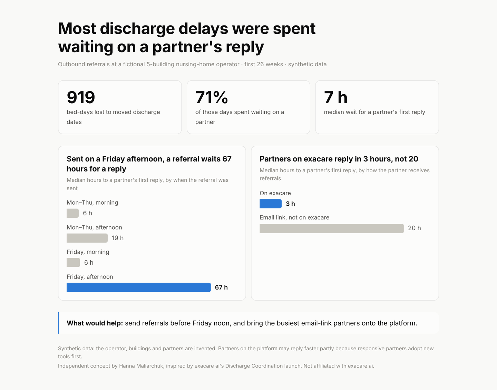

# Outbound Referral Analytics

A reporting concept for outbound referrals in skilled nursing: which partners answer and accept, why discharge dates move, and what that costs in bed-days. Built end to end on synthetic data, from simulation to SQL to dashboard.

**Live dashboard:** https://annmaliarchuk.github.io/outbound-referral-analytics/



## Why this project

When a resident is ready to leave a skilled nursing facility, the care team sends referrals to home health agencies, hospices, DME suppliers, dialysis centers and other facilities, then waits for answers while the discharge date holds or slips. Platforms such as exacare ai's [Discharge Coordination](https://www.exacare.com/resources/blog/introducing-discharge-coordination) now capture that whole trail in one system. Inbound referral reporting is well established; this project sketches the outbound side and the questions it can answer:

- How far do referrals get, and where do they stall?
- Which partners answer fast and accept, and which ones do buildings keep using anyway?
- How many bed-days are lost when discharge dates move, and how much of that is waiting on a partner?
- What simple habits would move dates less?

## Findings (synthetic data, all buildings, 26 weeks)

| # | Finding | Action it points to |
|---|---|---|
| 1 | Referrals sent **Friday after noon** wait a median **66.6 h** for a first answer, vs 5.6 h Monday–Thursday mornings. | Send Monday-discharge referrals before Friday noon; prompt it in the workflow. |
| 2 | With **under 2 days** of planning notice, **68%** of discharge dates move; with over 3.5 days, 26%. Willow starts a median 2.0 days out and 58% of its dates move. | Start referrals when the date is set; keep a daily at-risk list. |
| 3 | Keystone Home Care serves two buildings, yet **82%** of its declines are "outside service area". | Store service areas in the provider directory; warn before sending. |
| 4 | Riverbend Home Care gets **19%** of first-round home health referrals but accepts **37%**; BrightPath accepts 82%. | Suggest partners ranked by acceptance and speed. |
| 5 | **72%** of referrals go to email-link partners, who answer in a median **19.7 h** vs 3.0 h in-platform. | Treat high-volume email-link partners as invite targets; test with a pilot. |

Overall, **919 bed-days** were lost to date changes, **71%** of them while waiting on a partner.

## How it's built

```
src/generate_data.py   →  data/*.csv          seeded simulation, six tables
sql/schema.sql         →  data model          PostgreSQL / DuckDB
sql/metrics.sql        →  metric definitions  M1–M7, tested with src/run_sql.py
src/build_dashboard.py →  docs/data.js        the few figures the dashboard shows, same logic as the SQL
docs/index.html        →  the dashboard       one screen, plain HTML/CSS/JS, no libraries
```

```
├── data/          six CSV tables (synthetic)
├── docs/          dashboard served by GitHub Pages
├── sql/           schema.sql, metrics.sql
├── src/           generate_data.py, build_dashboard.py, run_sql.py
└── requirements.txt
```

## Run it

```bash
pip install -r requirements.txt
python src/generate_data.py      # writes data/*.csv (seed 3; SEED=n to vary)
python src/build_dashboard.py    # writes docs/data.js
python src/run_sql.py            # runs every metric query in DuckDB
python -m http.server -d docs    # then open http://localhost:8000
```

To publish: **Settings → Pages → Deploy from a branch → `main` / `docs`**.

## Data model

| Table | One row per |
|---|---|
| `facilities` | building |
| `provider_directory` | partner (type, in-platform or email link, service area) |
| `discharge_plans` | planned discharge (payer, services needed, planned vs actual date, return within 30 days) |
| `outbound_referrals` | referral to one partner (sent, opened, answered, decision, decline reason, final status) |
| `referral_events` | activity-log event (sent, opened, info requested, document uploaded, accepted, declined, selected, closed) |
| `discharge_date_changes` | change to a discharge date, with its reason |

Column-level detail is in [`sql/schema.sql`](sql/schema.sql).

## What the simulation models

- Partners answer on business hours (hospices also on weekends); in-platform partners open and answer faster than email-link partners.
- Social workers wait a building-specific time, then try the next partner; some buildings send home health referrals to several agencies at once.
- Partners decline for capacity, clinical fit, payer, incomplete packets, or because the building is outside their service area.
- Discharge dates move when no partner has accepted in time, DME hasn't arrived, authorization is pending, the family isn't ready, or the resident's condition changes.
- Some residents return to the same building within 30 days, at a rate that depends on their home health or hospice partner.

## Caveats

- **All data is synthetic.** The operator, buildings and partners are invented; the patterns were modelled, not observed.
- The in-platform speed gap is an association: responsive partners may be the ones who adopt tools.
- Bed-days are attributed to the first reason in the date-change log.
- In production, 30-day returns would come from matching inbound referrals to earlier discharges (sketched as M8 in `metrics.sql`), which needs reliable resident matching.

---

Independent concept by **Hanna Maliarchuk**. Not affiliated with or endorsed by exacare ai.
